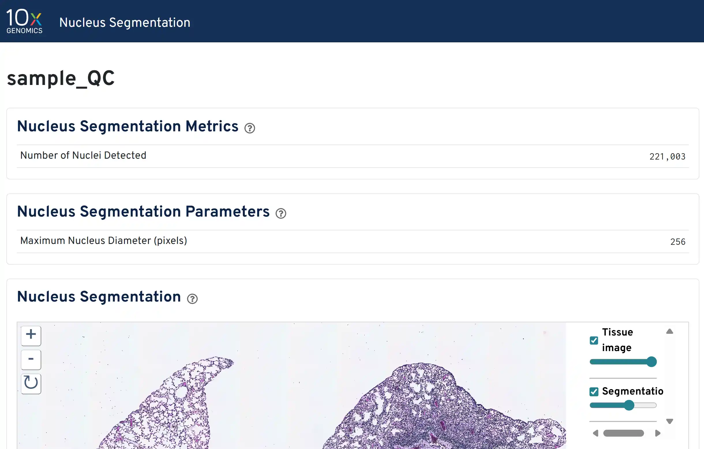

# Visium HD Nuclei Segmentation QC on Windows (WSL2)

A complete workflow for running `spaceranger segment` on Windows using WSL2,

designed for researchers who do not have access to a dedicated Linux workstation.

This workflow covers:

1. Cropping a 6.5 × 6.5 mm or 11 × 11 mm H&E region from a whole-slide image using QuPath
2. Running `spaceranger segment` in WSL2 (Ubuntu 22.04)
3. Interpreting the output for RNA per cell QC

---

## Background

`spaceranger segment` (available since Space Ranger v4.0) performs nuclear

segmentation on H&E images to estimate cell counts — a key QC step before

committing samples to the Visium HD assay.

> **Important:** `spaceranger segment` cannot be run on 10x Genomics Cloud.
>
> It must be run locally on a Linux environment.
>
> Reference: *CG001678 Visium HD FFPE Tissue Preparation Handbook 2.0*

10x Genomics official documentation assumes a bare-metal Linux workstation.

This guide fills the gap for Windows users.

---

## Hardware Requirements

### 10x Genomics Official Requirements (Space Ranger 4.x)

| Component | Minimum                                   | Recommended |
| --------- | ----------------------------------------- | ----------- |
| CPU       | 8-core Intel/AMD (AVX support required)   | 32 cores    |
| RAM       | 64 GB                                     | 128 GB      |
| Storage   | 1 TB free                                 | —          |
| OS        | 64-bit CentOS/RedHat 7.0 or Ubuntu 14.04+ | —          |

> **Note:** WSL2 is **not** officially supported by 10x Genomics.
>
> The above requirements are for `spaceranger count` (full pipeline).
>
> `spaceranger segment` (image-only, no genome alignment) requires
>
> significantly less RAM in practice.

### Tested Configuration (spaceranger segment only, 6.5 mm baseline)

| Component  | Spec                    | Notes                                    |
| ---------- | ----------------------- | ---------------------------------------- |
| Machine    | HP EliteBook 835        | Windows 11 Pro                           |
| CPU        | AMD Ryzen Pro (8 cores) | AVX2 supported                           |
| RAM        | 32 GB physical          | WSL2 allocated 24 GB                     |
| WSL2 Swap  | 8 GB                    | Configured in `.wslconfig`             |
| Storage    | Micron P310 NVMe SSD    | External, files copied to WSL2 native FS |
| OS (WSL2)  | Ubuntu 22.04 LTS        | —                                       |
| Image size | 1.7 GB TIFF             | 6.5 × 6.5 mm @ 0.26455 µm/px           |
| Runtime    | ~17 minutes             | 8 cores / 20 GB RAM                      |

> ⚠️ **16 GB RAM machines (e.g. Surface Pro 9) are not recommended.**
>
> Standard Visium HD H&E images (~1.7 GB) may exceed available WSL2 memory.
>
> 32 GB physical RAM is the practical minimum for reliable execution.

---

## Software Requirements

* [QuPath 0.6+](https://qupath.github.io/) (Windows)
* [Space Ranger 4.0+](https://www.10xgenomics.com/support/software/space-ranger/downloads) (installed in WSL2)
* WSL2 with Ubuntu 22.04

---

## WSL2 Setup

### 1. Install WSL2

```powershell
# Run in PowerShell (Administrator)
wsl --install -d Ubuntu-22.04
```

### 2. Configure memory allocation

Create or edit `C:\Users\<your_username>\.wslconfig`:

```ini
[wsl2]
memory=24GB
processors=8
swap=8GB
```

Restart WSL2 after editing:

```powershell
wsl --shutdown
wsl
```

Verify memory allocation inside WSL2:

```bash
free -h
# Should show ~23 GB total
```

### 3. Install Space Ranger

```bash
# Create working directory inside WSL2 native filesystem (NOT /mnt/)
mkdir -p ~/spaceranger_work/input
mkdir -p ~/spaceranger_work/output

# Download Space Ranger from 10x Genomics website (requires login)
# Then extract:
cd ~/spaceranger_work
tar -zxvf spaceranger-4.x.x.tar.gz

# Verify installation
~/spaceranger_work/spaceranger-4.x.x/spaceranger --version
```

> ⚠️ **Critical:** Always use the WSL2 native filesystem (`~/`, `/home/user/`)
>
> as the working directory. Never run spaceranger with input/output on
>
> `/mnt/d/` or other Windows-mounted paths — the NTFS filesystem does not
>
> support Linux symlinks, which will cause Martian runtime errors:
>
> `symlink ... operation not permitted`

---

## Step 1: Crop H&E Image in QuPath

### Why crop?

Whole-slide images are typically stored as compressed formats (e.g. SVS ~500 MB).

However, exporting a region as uncompressed TIFF expands the file significantly.

At the same pixel size, an 11 × 11 mm crop contains approximately
`(11 / 6.5)^2 = 2.86` times as many pixels as a 6.5 × 6.5 mm crop.
For 8-bit RGB at 0.26455 µm/px, the raw pixel data alone are approximately
1.8 GB and 5.2 GB, respectively (decimal GB); actual TIFF sizes depend on
compression and metadata.

An uncompressed 11 mm image at this resolution can exceed classic TIFF's
4 GiB limit. If export fails because of this limit, use a BigTIFF-capable
exporter and verify that the resulting image opens correctly and is accepted
by your installed Space Ranger version. These scripts retain QuPath's
`writeImageRegion` call and do not explicitly select a TIFF writer or compression.

Cropping is still necessary because:

* `spaceranger segment` requires a standard TIFF input, not SVS or other WSI formats
* Processing the full slide would require far more memory and time
* Only the region corresponding to the Visium HD capture area is relevant for QC

### 1a. Identify the region of interest

Use **Objects → Annotations → Specify annotation** to place a precise

rectangle matching your capture area on your tissue:

| Capture area | Width (µm) | Height (µm) | Selected-annotation script |
| --- | --- | --- | --- |
| 6.5 × 6.5 mm | 6500 | 6500 | [`crop_visiumhd_selected_annotation.groovy`](scripts/crop_visiumhd_selected_annotation.groovy) |
| 11 × 11 mm | 11000 | 11000 | [`crop_visiumhd_11mm_selected_annotation.groovy`](scripts/crop_visiumhd_11mm_selected_annotation.groovy) |

```
Objects
└── Annotations...
    └── Specify annotation
        ├── X: <left edge position in µm>
        ├── Y: <top edge position in µm>
        ├── Width:  6500 or 11000
        └── Height: 6500 or 11000 (same as Width)
```

Adjust X/Y until the rectangle covers your tissue of interest.

The annotation will appear on the image for visual confirmation.

### 1b. Check pixel size (first time only)

Run this snippet in  **Automate → Script Editor** :

```groovy
def server = getCurrentServer()
def ps = server.getPixelCalibration().getAveragedPixelSizeMicrons()
print "Pixel size: ${ps} µm/px"
```

Record this value for documentation. The recommended export script below reads
the pixel size directly from the image calibration, but recording it helps catch
scanner or file-conversion problems.

### 1c. Export the cropped region

Select your rectangle annotation in the Annotations panel, then open the
matching script from the table above in **Automate → Script Editor**.
The existing filename remains the 6.5 mm version; the separate 11 mm script
uses `TARGET_SIZE_UM = 11000.0`.

**For each slide, edit `outputFile` and use a unique filename:**

```groovy
// 6.5 mm script
def outputFile = new File('C:/path/to/output/cropped_he_6_5mm.tif')

// 11 mm script
def outputFile = new File('C:/path/to/output/cropped_he_11mm.tif')
```

The output directory must already exist. These are alternative settings in
separate scripts; do not paste both declarations into the same script.

Both scripts use the selected annotation, read the image pixel calibration,
check the annotation dimensions against the selected capture size (±25 µm),
check image bounds, and export a full-resolution square crop centered on the
annotation. Use an axis-aligned rectangle and confirm that the image has valid,
square-pixel calibration: the current implementation uses the averaged pixel size.

The scripts were reported by the author to work on the original laptop.
A locally inspected segmentation report confirms a Space Ranger 4.1.0 run with
`--localcores=8 --localmem=20` and no reported alarms. The report does not by itself
identify which crop script or capture size produced the input, or establish an
11 mm runtime/memory benchmark. The report is not included in this repository.
This repository update was checked statically; QuPath export and Space Ranger
segmentation were not rerun during the update.

### 1d. Manual centroid fallback

The older script, [`scripts/crop_visiumHD.groovy`](scripts/crop_visiumHD.groovy),
is kept as a fallback when you need to reproduce a crop from explicit centroid
coordinates instead of using the selected annotation.

For that workflow, edit these values before running the script:

```groovy
def centerX_um = 3132.14   // Centroid X µm from Annotations panel
def centerY_um = 4745.63   // Centroid Y µm from Annotations panel
def outputFile = new File('C:/path/to/output/cropped_he_6_5mm.tif')
```

---

## Step 2: Mount External SSD and Transfer Image to WSL2

### 2a. Mount external SSD (if not auto-mounted)

External drives are not always automatically mounted in WSL2. Check first:

```bash
ls /mnt/
# If d/ is not listed, mount manually:
sudo mkdir -p /mnt/d
sudo mount -t drvfs D: /mnt/d
```

Verify the drive is accessible:

```bash
ls /mnt/d/
```

> **Note:** You need to remount after every WSL2 restart (`wsl --shutdown`).
> To avoid this, add the following to `/etc/fstab` inside WSL2 for automatic mounting:
>
> ```
> D: /mnt/d drvfs defaults 0 0
> ```

### 2b. Transfer image to WSL2 native filesystem

The commands below use the 6.5 mm filename. For an 11 mm crop, replace
`cropped_he_6_5mm.tif` with `cropped_he_11mm.tif` throughout and choose a unique
run ID and output directory.

```bash
# Copy from Windows-mounted SSD into WSL2 native filesystem
cp /mnt/d/visium_QC/cropped_he_6_5mm.tif ~/spaceranger_work/input/

# Verify file integrity
ls -lh ~/spaceranger_work/input/
```

---

## Step 3: Run spaceranger segment

```bash
/home/<username>/spaceranger_work/spaceranger-4.1.0/spaceranger segment \
  --id=tumor_20260602_1 \
  --tissue-image=/home/<username>/spaceranger_work/input/cropped_he_6_5mm.tif \
  --output-dir=/home/<username>/spaceranger_work/output/tumor_20260602_1 \
  --localcores=8 \
  --localmem=20
```

> **Note:** Use absolute paths (e.g. `/home/jychen/...`) instead of `~/`.
> The `--tissue-image` argument does not expand `~` correctly.

> ⚠️ **Important: `--id` and `--output-dir` must both be changed for each new sample.**
> Spaceranger keeps a pipestance record in the output directory. If you reuse the same
> `--output-dir` with a different `--id`, it will throw:
> `RuntimeError: pipestance already exists with different invocation file`
> Always use a unique name (e.g. sample name or date) for both `--id` and `--output-dir`.

### Running multiple samples

```bash
# Sample 1
/home/<username>/spaceranger_work/spaceranger-4.1.0/spaceranger segment \
  --id=tumor_20260602_1 \
  --tissue-image=/home/<username>/spaceranger_work/input/cropped_HE_1.tif \
  --output-dir=/home/<username>/spaceranger_work/output/tumor_20260602_1 \
  --localcores=8 --localmem=20

# Sample 2
/home/<username>/spaceranger_work/spaceranger-4.1.0/spaceranger segment \
  --id=tumor_20260602_2 \
  --tissue-image=/home/<username>/spaceranger_work/input/cropped_HE_2.tif \
  --output-dir=/home/<username>/spaceranger_work/output/tumor_20260602_2 \
  --localcores=8 --localmem=20
```

### Cleaning up old runs

If you need to rerun a sample and want to clear previous results:

```bash
# Remove a specific run
rm -rf /home/<username>/spaceranger_work/output/tumor_20260602_1

# Or remove all outputs and start fresh
rm -rf /home/<username>/spaceranger_work/output
mkdir /home/<username>/spaceranger_work/output
```

**Expected runtime (6.5 mm baseline):** 15–30 minutes for a 1.7 GB image on 8 cores / 20 GB RAM.

The 11 mm crop contains approximately 2.86 times as many pixels at the same
resolution. Runtime and peak memory for 11 mm have not been benchmarked here;
do not assume that the 6.5 mm estimates apply.

### Outputs

```
output/<sample_id>/outs/
├── nucleus_instance_mask.tiff     # Per-nucleus segmentation mask
├── nucleus_segmentations.geojson  # Nucleus boundary coordinates
└── web_summary.html               # QC report (open in browser)
```

---

## Step 4: View Results

Copy the web summary to Windows:

```bash
cp /home/<username>/spaceranger_work/output/tumor_20260602_1/outs/web_summary.html /mnt/d/visium_QC/
```

Open `web_summary.html` in any browser. Key metric:

```
Nucleus Segmentation Metrics
└── Number of Nuclei Detected: XXXXXX
```

---

## Step 5: Calculate RNA per Cell

Per the 10x Genomics official QC protocol ( *CG001678* ):

```
RNA per cell (pg) = Total RNA in 5 µm section (pg) ÷ Number of Nuclei Detected
```

### Decision thresholds (10x Genomics official)

| RNA per cell   | Interpretation      | Recommendation       |
| -------------- | ------------------- | -------------------- |
| < 0.4 pg       | Poor sample quality | Do not proceed       |
| 0.4 – 0.75 pg | Moderate quality    | Proceed with caution |
| > 0.75 pg      | Good quality        | Proceed              |

### Example calculation

```
Total RNA: 1,725 ng in 5 µm section
          = 1,725,000 pg

Nuclei detected: 221,003

RNA per cell = 1,725,000 ÷ 221,003 = 7.8 pg/cell → Proceed ✅
```

---

## Example Output

A successful run produces the following web summary:



Key metric to record for RNA per cell calculation:

```
Nucleus Segmentation Metrics
└── Number of Nuclei Detected: 221,003
```

---

## Troubleshooting

| Error                                                        | Cause                                                             | Fix                                                                                                |
| ------------------------------------------------------------ | ----------------------------------------------------------------- | -------------------------------------------------------------------------------------------------- |
| `symlink ... operation not permitted`                      | Working directory on NTFS (`/mnt/`)                             | Move all files to WSL2 native FS                                                                   |
| `No such file or directory`for `--tissue-image`          | `~`not expanded                                                 | Use full absolute path `/home/user/...`                                                          |
| `unexpected argument '--image'`                            | Wrong flag name in SR 4.x                                         | Use `--tissue-image`                                                                             |
| `pipestance already exists with different invocation file` | `--output-dir`reused from previous run                          | Change both `--id`and `--output-dir`for each new sample, or `rm -rf`the old output directory |
| `web_summary: null`/ Reattaching in local mode             | Spaceranger reattached to old pipestance instead of running fresh | Same as above — use a new `--output-dir`each time                                               |
| External SSD not accessible at `/mnt/d/`                   | Drive not auto-mounted in WSL2                                    | Run `sudo mount -t drvfs D: /mnt/d`manually                                                      |
| OOM / process killed                                         | WSL2 RAM too low                                                  | Increase `.wslconfig`memory, reduce `--localmem`                                               |
| Martian UI not accessible in browser                         | WSL2 network isolation                                            | Normal — does not affect execution                                                                |

---

## References

* [Visium HD Gene Expression 2.0 User Guide (CG001679; 6.5 mm and 11 mm capture areas)](https://cdn.10xgenomics.com/image/upload/v1775578153/support-documents/CG001679_VisiumHD_GeneExpression_2.0_UG_Rev_A.pdf)
* [Space Ranger System Requirements](https://www.10xgenomics.com/support/software/space-ranger/downloads/space-ranger-system-requirements)
* [spaceranger segment documentation](https://www.10xgenomics.com/support/software/space-ranger/latest/analysis/running-pipelines/space-ranger-segment)
* [CG001678 Visium HD FFPE Tissue Preparation Handbook 2.0 (10x Genomics)](https://www.10xgenomics.com/support/spatial-gene-expression-hd/documentation/steps/tissue-prep-for-ffpe/visium-hd-ffpe-tissue-preparation-handbook-2-0)
* [CG001679 Visium HD Spatial Gene Expression 2.0 User Guide (10x Genomics)](https://www.10xgenomics.com/support/cn/spatial-gene-expression-hd/documentation/steps/library-construction/visium-hd-spatial-gene-expression-reagent-kits-user-guide-2-0)

---

## License

MIT
